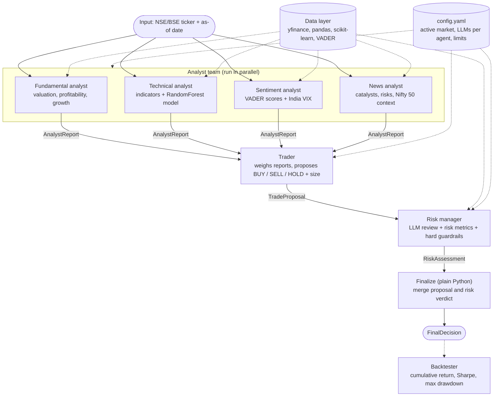
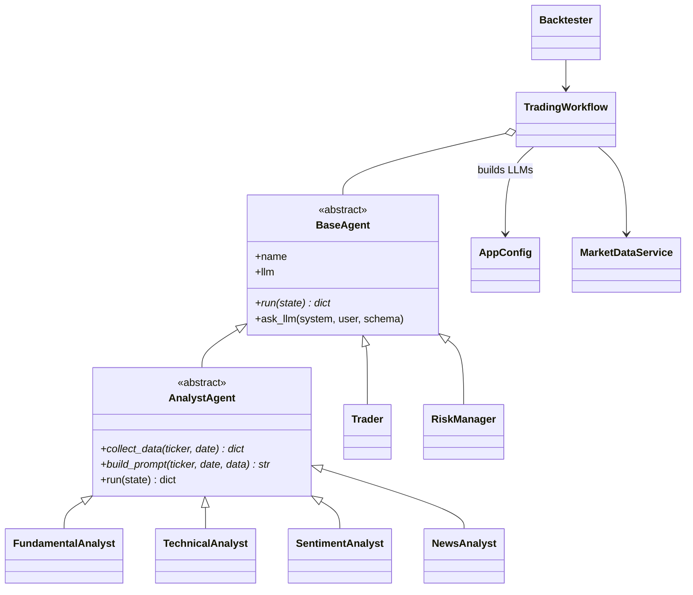

# RIO – Architecture

RIO is a multi-agent LLM framework that imitates a professional trading desk:
specialist analysts study a stock, a trader proposes an action, and a risk
manager reviews it before a decision is produced. It is built only with
**LangGraph**; phase 1 targets the **Indian market (NSE/BSE)** only. Data and ML models come from standard Python libraries.

> **Scope: base version (~30%).** This version delivers the agents, the
> structured communication and the LangGraph workflow, plus performance
> evaluation. Memory, bull/bear debate and live trading are intentionally left
> for later (see [Roadmap](#roadmap)).

## 1. Workflow diagram

### Shared state

All nodes read and write one `TradingState` dictionary ([core/state.py](core/state.py)):

| Key | Written by | Type |
|---|---|---|
| `ticker`, `as_of_date` | input | str |
| `analyst_reports` | the 4 analysts (appended, parallel-safe reducer) | list of `AnalystReport` |
| `trade_proposal` | trader | `TradeProposal` |
| `risk_assessment` | risk manager | `RiskAssessment` |
| `final_decision` | finalize | `FinalDecision` |

## 2. Components

| Folder / file | Responsibility |
|---|---|
| [config/config.yaml](config/config.yaml) | LLM definitions, which agent uses which, the active market (India: suffixes, Nifty 50, India VIX, INR, risk-free rate), trading limits, backtest dates |
| [config/loader.py](config/loader.py) | Reads the YAML and builds chat models (`AppConfig.create_llm`) – no provider classes |
| [core/schemas.py](core/schemas.py) | Pydantic messages between agents (structured communication) |
| [core/state.py](core/state.py) | LangGraph state |
| [data/market_data.py](data/market_data.py) | `MarketDataService`: ticker normalisation (RELIANCE -> RELIANCE.NS), prices, fundamentals, news (yfinance), date-safe |
| [data/indicators.py](data/indicators.py) | RSI, MACD, Bollinger, ATR, moving averages (pandas) |
| [data/ml_models.py](data/ml_models.py) | `DirectionPredictor` (scikit-learn RandomForest) and `NewsSentimentScorer` (VADER) |
| [agents/base_agent.py](agents/base_agent.py) | `BaseAgent` (LLM + structured output) and `AnalystAgent` (template for analysts) |
| `agents/*_analyst.py`, `trader.py`, `risk_manager.py` | One file per agent |
| [workflow/trading_graph.py](workflow/trading_graph.py) | `TradingWorkflow`: creates agents and wires the graph |
| [evaluation/metrics.py](evaluation/metrics.py) | Cumulative return, Sharpe ratio, max drawdown, VaR, volatility |
| [evaluation/backtest.py](evaluation/backtest.py) | Walk-forward backtest vs buy-and-hold |
| [main.py](main.py) | CLI (`analyze`, `backtest`) |

### Class design

## 3. Design decisions

1. **Facts first, LLM second.** Analysts fetch real numbers (ratios, indicators, ML probabilities, VADER scores) and the LLM only *interprets* them. If no data exists, the analyst reports "no view" with confidence 0 without calling the LLM, so it cannot invent analysis.
2. **Structured communication.** Agents exchange validated Pydantic objects, not paragraphs, so nothing is lost or reinterpreted between steps and every decision is traceable.
3. **Models as evidence, never as the decision.** The RandomForest reports its validation accuracy next to the always-predict-up baseline, so the LLM can see when the model is no better than chance.
4. **Layered risk control.** LLM judgement, then deterministic guardrails (position cap, REJECT → size 0) that hold even if the LLM misbehaves.
5. **Config-driven LLMs and market.** Change a model, give different agents different models, or (later) switch market by editing YAML only. Phase 1 ships and tests India only.
6. **Honest backtesting.** Prices are point-in-time; fundamentals and news are disabled in backtests because the free data source cannot provide their history.

## 4. How it relates to the reference papers

The brief is closest to **TradingAgents** (multi-agent firm with analyst, researcher, trader and risk roles). The papers you named contribute these ideas:

| Paper | Idea used in this base version | Idea deferred |
|---|---|---|
| FinCon: A Synthesized LLM Multi-Agent System with Conceptual Verbal Reinforcement for Enhanced Financial Decision Making | Manager/analyst hierarchy; risk control as its own step; evaluation by cumulative return, Sharpe, max drawdown | Verbal reinforcement and episodic memory (belief updates from past P&L) |
| FinVision: A Multi-Agent Framework for Stock Market Prediction | Separation of specialist agents feeding a decision-maker | Multi-modal chart input and the reflection agent |
| Enhancing Investment Analysis: Optimizing AI-Agent Collaboration in Financial Research | Role-specialised agents with structured hand-offs instead of free-form all-to-all chat | Exploring other collaboration structures / more agent roles |
| TradingAgents (Xiao et al., 2024) | Overall desk structure, structured reports | Bull/bear researcher debate, three-perspective risk team |

*These mappings reflect my understanding of the papers; please check them against the originals before citing them in the project report.*

## 5. Roadmap

| Stage | Adds |
|---|---|
| Base (this version, ~30%) | Analysts, trader, risk manager, LangGraph workflow, config-driven LLMs, ML evidence, backtest metrics |
| Next | Reliable Indian news source (yfinance has almost none for NSE tickers); Bull vs bear researcher debate; risk-seeking / neutral / conservative risk team; portfolio of several stocks |
| Later | Memory and reflection (FinCon-style), chart-image analysis (FinVision-style), human approval step (LangGraph interrupts), live data and paper trading |
